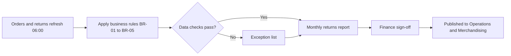

# Process map: monthly returns report

## Current state (manual, about 3 days)

1. Operations exports store returns from the till system to a spreadsheet.
2. Finance exports refunds from the ledger to a second spreadsheet.
3. An analyst matches the two by hand, using store names and dates.
4. Differences are discussed by email, usually over two or three days.
5. The final numbers are copied into a slide deck.

**Pain points:** two sources of truth, manual matching, no audit trail, and different definitions of a return.

## Future state (automated, about one hour)

**What changes:** one data source, one set of rules, and an exception list in place of email threads.
